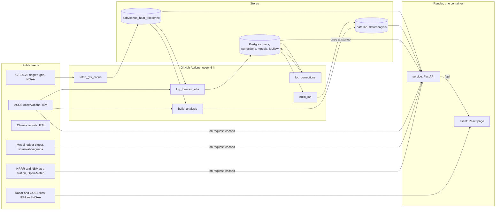
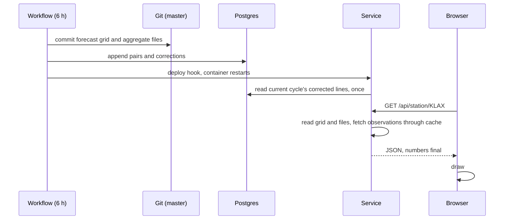
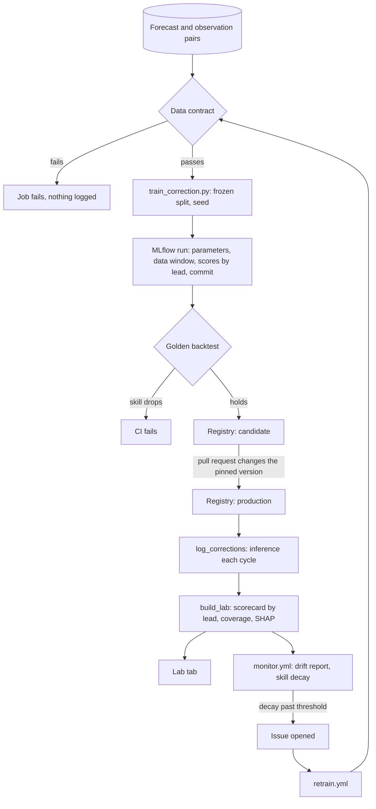
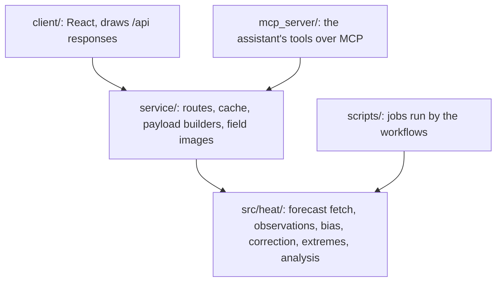

# Architecture

One scheduled workflow fetches the forecast, logs it against observations, runs the
correction model and writes small files. One service reads those files and serves one
page. Python builds every number and every image; the page only draws. The model has a
lifecycle of its own: trained by a script, tracked, gated, monitored and retrained.

This document describes the target and marks each part as **built** or **planned** with
the issue that delivers it. It changes in the same pull request as the code it describes.
The order of work is in [PLAN.md](PLAN.md); how a change moves is in
[process/WORKFLOW.md](process/WORKFLOW.md); decisions are in [decisions/](decisions/).

## 1. The system

| Part | State | Issue |
|---|---|---|
| GFS fetch, pair logging, shadow inference, commit and deploy hook | built | |
| Dash page (`app.py`) | built, retired at the cutover | #39 |
| `service/` and `client/`: Map, Satellite | built, served at the cutover | #35, #39 |
| Forecast and Stations tabs | built, served at the cutover | #36, #39 |
| `build_lab` and the Lab tab | planned | #38 |
| Upper air overlays, deep stations from the ledger | planned | #41 |
| `build_analysis` and the analysis overlay | planned | #42 |
| Assistant, evaluation suite, MCP server | planned | #43 |

## 2. Jobs write, routes read

A route never trains, scores or fits. It reads what a job wrote, or fetches a public feed
through a cache that keeps the last good value. This keeps the page fast, keeps the
container small, and means every number on the page can be reproduced from a file and a
commit.

One computation is done on request, and it is the exception that shows the rule. The
same-day correction on the Forecast tab is the mean error of today's forecast at one
station, from observations that arrive between the six-hourly jobs. It is one call to
`src/heat/bias.py` on cached observations, it trains nothing, and it is labelled apart
from the learned correction, which is always read as logged.

Rules that follow from it:

1. No metric is typed by hand. A number in a document comes from a file a job wrote.
2. Only aggregates are committed. The forecast and observation pairs stay in the database.
3. The age of the data is computed when it is shown (`src/heat/freshness.py`).

## 3. The model lifecycle

The model is a gradient-boosted correction of the GFS 2 m temperature at each station,
with a conformal band. It runs in shadow every cycle and is scored against the
observations that arrive afterwards.

| Part | State | Issue |
|---|---|---|
| Features and inference (`src/heat/correction.py`), shadow logging | built | |
| Training in notebooks 03 and 05, results in `ml/EXPERIMENTS.md` | built | |
| Training as a script, MLflow, data contracts, golden backtest, model card | planned | #37 |
| Scorecard by lead, coverage, SHAP, feature importance | planned | #38 |
| The correction trained on HRRR, scored beside the GFS-based one | planned | #48 |
| Drift report, skill decay, retraining, promotion by pull request | planned | #40 |

## 4. Layering

Dependencies point one way. The science does not know a service exists; the page does
not know how a number was made.

| Layer | May import | Read line by line by a person |
|---|---|---|
| `src/heat/` | numpy, pandas, xarray, scipy | yes |
| `scripts/` | `src/heat/` | training and backtest scripts |
| `service/` | `src/heat/`, FastAPI | payload builders |
| `client/` | nothing in Python; `/api` only | no, covered by tests and the contract check |

## 5. Deployment

One Docker container on Render serves the page. The scheduled workflow commits the new
forecast grid to `master` and calls Render's deploy hook, so each cycle is a fresh
container that loads its data once. Secrets (the database URL, the deploy hook) live in
GitHub and Render settings and never in the repo.
